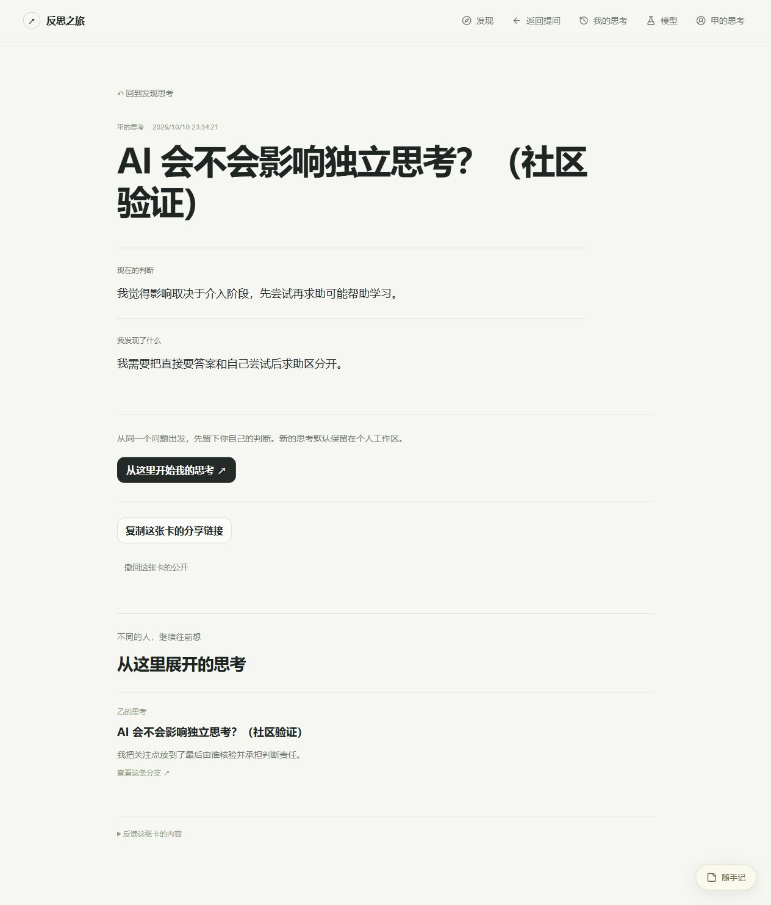

# V0.6 本机验收记录

整理日期：2026-10-15（Asia/Shanghai）。先前阶段检查及部分合成测试记录在 10 月 10 日开始，最终闭环在本次继续开发中完成。

## 环境和执行结果

- 当前工程目录：`reflective-journey-v0.4`，应用版本 0.6.0。
- Windows，Node.js 24.13.1，使用内置 SQLite；启动和测试有预期的实验性模块提示。
- V0.5.2 合入后：63 / 63 原有自动检查通过，Windows 生产构建通过。
- V0.6 最终：`npm test` 为 **78 / 78 通过，0 失败**；`npm run build` 的 TypeScript 和 Vite 生产构建通过。
- 测试模型为本机模拟 Provider；本轮没有发出真实模型调用。已有模型配置和密钥未被覆盖。
- 单独的本机数据库和 Cookie 名用于界面验收，测试服务仅绑定 `127.0.0.1:5190`；未公开到互联网。

## 自动化覆盖

原有 63 项认知质量、服务端、数据迁移、导出、随手记与停顿询问检查仍通过。新增 15 项见 `tests/community.test.mjs`：

1. 账户登录、大小写归一、口令和令牌摘要、HttpOnly Cookie、退出失效。
2. 拒绝跨站写入和匿名发布。
3. 两个持有独立 Cookie 的 HTTP 客户端完成甲分享、乙发现、乙发布关联成果。
4. 拒绝私密字段和伪造作者，重复提交不会产生重复卡片。
5. 非作者不能撤回；撤回后公众不可读，子卡不泄露撤回来源；作者仍有副本。
6. 真实服务端搜索和分页，错误游标得到明确回复。
7. Cookie 账户与旧页面工作区不一致时，拒绝发布和退出操作。
8. 模型接口登录要求、账户每日额度、两个账户独立计数。
9. 关闭并重新创建服务后，账号、登录令牌和卡片仍保留。
10. 浏览器账户空间隔离、访客记录主动带入、草稿复制及原访客数据保留。
11. 配置邀请码后才要求邀请码，客户端拿不到实际配置值。
12. 全站额度不能通过新增账户绕过，拒绝调用后数据库事务仍正常。
13. 接续会话真正从空认知状态开始，保留来源，第一问为形成自己的判断。
14. 分钟限额到期恢复，拒绝调用不污染每日计数。
15. 内容反馈去重并进入本机运营队列，处理后停止公开，作者副本和处理记录保留。

## 实际界面闭环

使用合成的「甲的思考」「乙的思考」两个账户，在本机生产构建上操作：

1. 甲围绕「AI 会不会影响独立思考？」完成个人思考；只勾选当前判断和发现并确认发布。
2. 刷新公开链接，仍可读取服务端卡片；未选择的疑问不出现在卡片。
3. 退出甲后个人记录消失于当前工作区，乙登录后历史初始为空。
4. 乙在发现中打开甲的卡片，从同一问题开始，首轮为自己的判断，零回答起步。
5. 乙表达「关键还包括是否保留最终判断责任」，与甲的「介入阶段」区别开；暂停与刷新后保留乙的记录和来源。
6. 乙整理并选择两项公开，预览包含作者和来源，发布后有甲的来源链接。
7. 切回甲，在「我的分享」打开原卡片，能看到乙的接续成果并打开分支；没有出现乙的撤回按钮。
8. 用甲提交合成内容反馈，页面显示已记录；本机运营脚本读到了对应反馈，未向公开页面暴露原因。
9. 检查手机窄屏卡片和分支可读、导航收为图标；DOM 内容宽度与视口宽度相同，无横向溢出。

界面验证发现并修复了重复 React key 导致的账户组件重复，以及命令行竞技场配置初始化顺序问题。账户页面读取旧访客存储失败时改为显示错误，不再让登录界面中断。

[窄屏截图](community-mobile-preview.png)。

## 限制与后续验收

当前证据为两独立 HTTP 客户端的服务端验证，以及同一浏览器切换两个账户的实际界面操作，**不是两台实体设备的现场验证**。

未进行公网部署、HTTPS 代理、并发负载、真实模型连续会话和真人留存实验。私密思考仍保存在各自浏览器，未实现私密内容云同步；没有找回密码和账户注销。模型次数额度也不能当作精确的费用预算。

下一轮应先在受邀小范围内观察：从阅读到开始独立思考、从开始到确认成果、从成果到自愿分享及再次回来；再根据真实中断点优化追问质量和思考接续体验。
