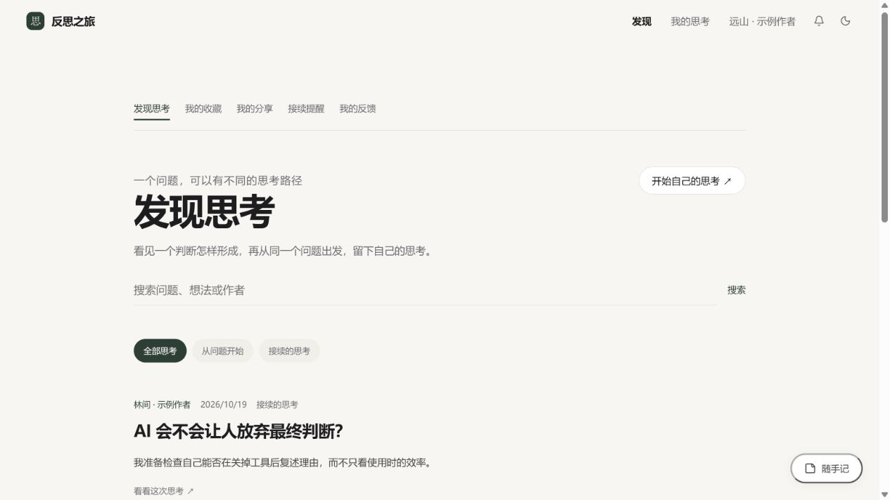

# V0.7 验收记录

日期：2026-10-19（Asia/Shanghai）。

## 自动化与构建

- Windows，Node.js 24.13.1。
- `npm test`：103 项通过，0 失败。原有 89 项全部保留，新增 14 项。
- TypeScript 和 Vite 生产构建通过。
- SQLite 在当前 Node 版本中会显示预期的实验性模块提示。
- 模型调用使用本机模拟 Provider，界面验收关闭真实模型；本轮未消耗真实模型额度。

新增检查见 `tests/community-features.test.mjs`：收藏隐私与撤回、公开资料投影、内容与作者搜索、筛选和字面通配符、105 张分享的分页、45 条接续的分页、接续提醒事务和幂等、编辑版本冲突及字段移除、运营权限、反馈闭环、停止公开时各入口的一致可见性、反馈变动冲突、旧账户身份拒绝、旧数据库无损升级与重启持久性、页面路由、网络失败与超时提示。

## 实际界面操作

使用独立数据库 `.qa/community-v07-20261019.sqlite`、独立 Cookie 名和 `127.0.0.1:5192` 验收。三个合成账户分别代表两位作者与运营者，示例内容不进入正常项目数据。

1. 访客在发现中切换接续筛选、打开作者主页；尝试收藏时引导进入账户。
2. 作者甲登录，编辑公开简介并保存；未读接续提醒能显示正确数量。
3. 打开提醒，进入作者乙的成果并标记已读；收藏该卡片，在“我的收藏”找到对应记录。
4. 甲编辑自己的公开卡片，修改发现并取消公开一项疑问；预览确认后详情移除对应字段、显示更新时间。
5. 甲提交内容反馈，在“我的反馈”看到等待状态。
6. 甲从乙的问题开始独立思考，首轮为零回答、自己的立场提问；输入自己的回答，确认成果后只选择两项发布。
7. 新成果显示甲→乙→甲的多层来源路径。切换到乙登录，立即看到新成果对应的一条未读接续提醒。
8. 运营账户在反馈队列填写说明并确认保留内容；已处理列表保留决定与说明。甲重新登录后能看到自己反馈的处理结果。
9. 普通作者页面不显示运营入口。真实停止公开的跨入口一致性、越权拒绝和过期版本冲突另由独立 HTTP 客户端自动化验证。
10. 检查浅色、深色与窄屏下的导航、卡片和来源路径；检查浏览器错误记录。

这不是两台实体设备的现场验证。跨用户服务端隔离由独立 Cookie 客户端检查，界面操作为同一浏览器切换三个合成账户。

## 截图

以下均来自独立合成测试库：

[来源路径与独立成果](community-v07-branch.png) · [运营处理记录](community-v07-moderation.png) · [深色社区](community-v07-dark.png)

## 交付边界

本轮完成当前单实例社区的功能补全与前端整合，未部署到公网。尚未验证真实用户规模下的负载、两台实体设备、公网 HTTPS、真人复访和真实模型连续会话质量。账户找回、邮件验证、账户注销、私密思考云同步和多实例运维仍未实现。

语音保留 V0.6.1 的实现；真实麦克风识别质量仍按 [语音验收说明](VOICE-INPUT.md) 列为待实际验证。
