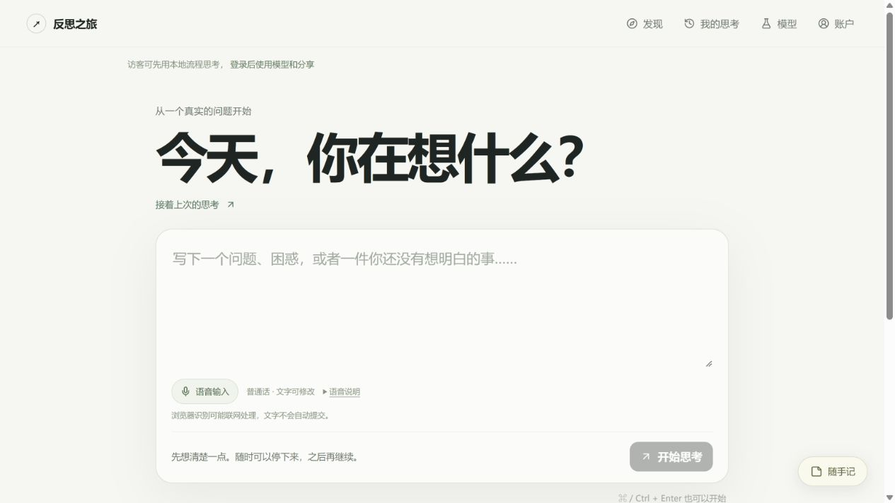

# V0.6.1 语音输入

日期：2026-10-19（Asia/Shanghai）。

## 使用

提问、每轮回答、随手记、岔开的念头都有「语音输入」按钮。点击后按浏览器提示授权麦克风，以普通话说出想法；识别确认的文字会追加到已有文字后面，原稿不被覆盖。可以边说边手动修改已经留下的文字。

点击「停止语音」或按 Esc 结束本段。提问和回答在语音结束后才能提交，应用不会自动开始思考、继续下一轮或分享。识别器还没确认的片段会单独展示；结束后可以检查并点击「采用这段文字」，不会被当作已经确认的内容悄悄写入。

同时只会有一处输入使用语音。切换到另一处、离开页面、切换账户、收起笔记或关闭对应输入区时会停止原识别，不自动在后台重启。单段最多两分钟；浏览器也可能在停顿后提前结束，此时可以再次点击按钮。

语音期间暂停「停顿时，温和地问问我」；停止后重新计时，避免说话被误判为走神。随手记和回答的确认文字沿用原有本机保存逻辑。

## 支持与隐私

使用浏览器的 `SpeechRecognition` 或 `webkitSpeechRecognition`，不增加服务端音频接口和模型密钥。需要 HTTPS 或本机安全来源（如 `127.0.0.1` / `localhost`），以及浏览器允许麦克风。

支持情况取决于浏览器及其语音服务。接口存在也不代表识别服务一定可连接；浏览器版本、网络和地区均可能影响结果。失败会显示具体提示，已确认文字保留，仍可继续打字。麦克风权限需用户自行允许，本次没有代替用户授权。

本应用不录制或保存音频文件，浏览器可能将声音发给它使用的识别服务。因此这不是离线识别承诺，也不能认为音频一定只留在本机。入口常驻说明可能联网处理；点击「语音说明」可查看完整提示。

识别文字先进入当前账户或访客的个人草稿，不因为使用语音而公开。以后主动提交回答时，文字与普通打字内容一样进入原有思考流程；若使用真实模型，相关文字会按该流程发往配置的模型服务商。社区仍需逐项选择、预览、确认发布。

官方参考：[MDN SpeechRecognition](https://developer.mozilla.org/en-US/docs/Web/API/SpeechRecognition)、[识别结果列表与临时结果](https://developer.mozilla.org/en-US/docs/Web/API/SpeechRecognitionEvent/results)。

## 实现

- `src/lib/voice-input.ts`：识别生命周期、最终结果位置去重、临时结果替换、错误处理、超时和全局单一活动识别器。
- `src/components/VoiceInput.tsx`：语音按钮、预览、状态与权限说明；页面隐藏、卸载和账户变化时释放识别器，并拒绝迟到文字写入新工作区。
- Home、ThinkingSessionView、QuickNotes、IdleCheckIn：将确认文本追加到各自原稿，沿用既有保存和提交入口。
- `tests/voice-input.test.mjs`：通过可控的模拟识别器验证，不读取真实麦克风。

## 本机验收

`npm test`：**89 / 89 通过**。原有 78 项继续通过，新增 11 项覆盖：

1. 能力与安全来源检测，不在检测时开启麦克风。
2. 追加原稿、换行与中英文边界。
3. 临时结果替换、缩短和最终结果去重。
4. 用户刻意重复的两句话不会按内容被误删。
5. 停止后接收最后一句，结束后的迟到结果被忽略。
6. 权限拒绝、网络错误和重新尝试。
7. 同步开启异常、权限等待超时释放。
8. 从回答切到笔记时只有一个活动识别器。
9. 卸载、离开或销毁后拒绝迟到回调。
10. 未确认片段只有主动采用时才追加，采用不会重复。
11. 两分钟时限、停止超时和临时片段恢复。

TypeScript 与 Vite 生产构建通过。浏览器在独立本机测试库上检查了四个语音入口、使用说明、原有文字输入和草稿保存、桌面与窄屏布局；未发现页面运行错误。没有改动真实个人记录、注册测试账户或发布卡片。

**尚未验证：真实麦克风录音到真实语音服务的识别质量、跨浏览器准确率、断网和地区网络可用性。** 自动测试使用模拟识别结果，界面手动输入的示例文字不能当作真实转写成功的证据。

